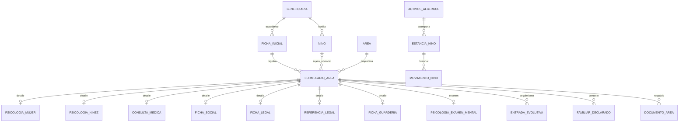

# Modelo y relaciones

## Una identidad y varios registros de atención

La ficha inicial continúa siendo la entrada al expediente. `beneficiaria` conserva nombre, CUI, nacimiento, catálogos y residencia. `nino` conserva los hijos ya vinculados mediante `beneficiaria_id`. Ningún formulario de área crea otra beneficiaria ni otro hijo por volver a capturar un nombre.

`formulario_area` apunta a `ficha_inicial`, conserva `beneficiaria_id` como dueña del expediente y usa `nino_id` opcional para identificar al hijo atendido. Si `nino_id` es nulo, la atendida es la beneficiaria. Si tiene valor, el atendido es el hijo. Una FK compuesta garantiza que el hijo pertenece a esa beneficiaria y otra garantiza que la ficha pertenece al mismo expediente. El CUI y el nombre no se usan como claves de relación.

La relación `ficha_inicial 1:N formulario_area` permite reevaluaciones sin sobrescribir la primera ficha de área. No se impone una única evaluación vitalicia ni un límite de consultas. Una eventual ficha de área única y revisable debe acordarse antes de añadir una restricción adicional.

Cada cabecera debe tener exactamente el detalle que corresponde a su tipo al terminar la transacción. El detalle médico comparte tabla entre sus tres variantes. Las claves compuestas y el trigger diferido impiden cabeceras sin detalle y detalles de otra variante. Los bloques complementarios son opcionales porque la obligatoriedad institucional de cada campo aún no está aprobada.

## Psicología

`psicologia_mujer` y `psicologia_ninez` contienen los campos propios de cada evaluación. `psicologia_examen_mental` contiene los doce componentes comunes. Los ejes I–V se preservan como texto porque están en el formulario; su uso clínico y significado deben validarse con el área. No se calculan diagnósticos ni puntuaciones.

La evaluación infantil incorpora embarazo y parto, hitos psicomotores con edad en meses, esfínteres, lenguaje, sueño, personalidad y dinámica familiar. Los datos de madre/padre/cónyuge se obtienen del expediente cuando existe un vínculo comprobado. Los datos declarados adicionales se guardan en `familiar_declarado`; nunca se infiere que el padre o cónyuge sea el agresor.

## Datos compartidos e historia

`v_identidad_formulario` devuelve nombre, CUI, nacimiento, número de ficha y edad a la fecha de atención. La edad no se persiste. Una fecha infantil desconocida devuelve edad nula; no se sustituye con la fecha de la madre.

`datos_generales_atencion` almacena contexto no cubierto por el diagrama o específico de la visita: religión, sexo registrado, lugar de nacimiento descrito, teléfono de contacto y las referencias a catálogos/residencia observadas. La interfaz precarga los datos maestros; modificar este contexto no cambia silenciosamente la ficha inicial.

La cabecera permite `identidad_al_atender`: fotografía mínima de la identidad usada al confirmar/imprimir, con esquema versionado definido por el backend (nombre, CUI, fecha_nac y correlativo; sin relatos clínicos). Es duplicación histórica intencional. Las vistas de identidad muestran el maestro vigente, no esa fotografía. Para reimprimir una versión histórica se usa su revisión y su fotografía histórica. El backend debe completar la fotografía en la confirmación; el SQL solo valida que sea objeto JSON.

`familiar_declarado.edad_referida_texto` transcribe una edad de terceros que no tienen fecha de nacimiento conocida; no es `edad_declarada` de beneficiaria o niño, ni se utiliza en indicadores. Si se conoce nacimiento, la edad del familiar también se calcula. Los conteos de hijos vivos/fallecidos son cifras reportadas a la fecha, no se deducen de hijos registrados incompletos ni crean identidades ficticias.

## Evolución sin sobrescritura

Cada nota, seguimiento social o actualización evolutiva es una fila de `entrada_evolutiva`, con acción obligatoria, contenido, profesional, capturista y fecha automática de registro. `fecha_atencion` representa cuándo ocurrió la atención y se distingue del instante de captura. La hoja por persona/área es una agrupación lógica de `v_hoja_evolutiva`, incluyendo todas sus evaluaciones. No se duplica el texto en la ficha social y en la hoja.

La tabla original `hoja_evolutiva` se conserva como legado. El símbolo de tipo JSON del diagrama motivó `jsonb` en la reconstrucción, pero se debe verificar el tipo real. No se convierten sus datos automáticamente. La migración debe crear entradas nuevas manteniendo una correspondencia con el ID anterior mediante `origen_sistema/origen_id` únicos y reconciliar conteos. `accion` nueva es texto no vacío hasta aprobar el catálogo; luego podrá agregarse una FK conservando las etiquetas históricas.

## Autoría, versiones y documentos

Profesional y capturista son identidades distintas. Los cambios de cabecera incrementan `version`; insertar o editar detalles también toca la cabecera. Un guardado con múltiples bloques puede incrementar la versión varias veces: el cliente utiliza siempre la versión final retornada, sin asumir incrementos de uno por petición. Las notas tienen además su versión propia.

Los triggers guardan valores anteriores y nuevos en `revision_registro` con usuario, motivo y fecha. El historial contiene información sensible y requiere acceso restringido: no es un log de aplicación. No se permite su modificación ni borrado mediante operaciones ordinarias. Los INSERT de este diseño también se auditan. El historial legado, las lecturas, descargas y accesos requieren integración adicional; los triggers de escritura no registran consultas.

La firma física se representa mediante un documento digital del mismo formulario cuando se escanea. Un nombre de profesional no equivale a una firma electrónica. Los documentos se guardan en almacenamiento privado; PostgreSQL conserva la clave, checksum y metadatos. Cada versión es una fila nueva ligada a su anterior; falta endurecer secuencia y linealidad de versiones en la implementación documental final. La firma no bloquea correcciones posteriores autorizadas.

## Albergue

Se preservan `activos_albergue` y `movimiento_albergue`. La ampliación añade estancias infantiles y sus movimientos para no suponer que un hijo siempre sale o regresa con su madre. Se bloquea una segunda estancia abierta de la beneficiaria o del hijo. No hay camas ni habitaciones.

La validación de estancia infantil comprueba familia y límites temporales al escribirla; el backend debe bloquear la estancia principal y cerrar/verificar las infantiles antes de egresar a la madre. También debe validar alternancia salida/retorno y sincronizar presencia. El SQL de referencia aún no implementa toda esa máquina de estados ni evita por sí solo una modificación posterior incompatible de la estancia principal. Es una brecha operativa explícita, separada del enlace de formularios.
