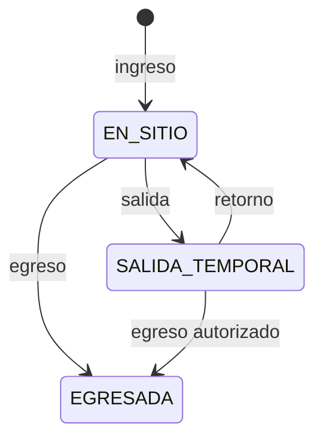

# Flujos y transacciones críticas

## Confirmar ficha inicial

1. Autenticar y autorizar `initial_intake.confirm` para el caso.
2. Bloquear el borrador y comparar versión.
3. Validar cabecera, 19 apartados, bloque de riesgo, catálogos y relaciones según reglas aprobadas.
4. Verificar/crear vínculos de hijas e hijos sin fusionar coincidencias automáticamente.
5. Generar correlativo atómico si corresponde.
6. Cambiar estado, aumentar versión y registrar auditoría.
7. Confirmar todo en una transacción. Un reintento con la misma clave devuelve el mismo resultado.

Cambiar de pestaña en el frontend nunca crea otra ficha. Guardar una sección modifica el mismo borrador.

## Corregir una ficha o registro de área

Comprobar capacidad, estado y versión; guardar revisión anterior; aplicar parche permitido; aumentar versión; auditar campos modificados sin copiar valores sensibles al log general. Una firma física registrada no vuelve inmutable el registro.

## Crear/editar evolución

La creación exige sujeto, área, acción y contenido. El servidor fija `recordedAt`; `attendedAt` solo se recibe si la regla permite una fecha de atención distinta. Si proviene de un seguimiento de área, usar `sourceType/sourceId` únicos. Editar crea revisión inmutable y auditoría; nunca reemplaza la evidencia histórica sin rastro.

## Documento

- **Carga:** crear intento, transferir objeto, validar, confirmar metadatos y versión.
- **Nueva versión:** conservar todas las anteriores y cambiar puntero vigente en transacción.
- **Consulta/descarga/impresión:** recalcular autorización en cada solicitud y auditar el evento correspondiente.
- **Anulación:** solo coordinación del área, con motivo; conservar objeto y versiones; impedir nuevas descargas ordinarias salvo capacidad histórica expresa.

## Inactivar/restaurar expediente

Solo Administración general. Exigir motivo, bloquear beneficiaria/expediente, comprobar estado, cambiarlo, aumentar versión, auditar y revocar acciones operativas incompatibles. Restaurar es otra operación con motivo y no elimina el período de inactividad. Definir antes de implementar qué sucede con estancias activas y trabajos pendientes.

## Albergue: ingreso

1. Autorizar y cargar identidad mínima.
2. Bloquear por persona/CUI normalizado.
3. Verificar ausencia de estancia abierta.
4. Crear estancia individual con fecha/hora del servidor.
5. Auditar y confirmar. El índice único resuelve carreras residuales.

Para una beneficiaria con hijas/hijos, cada persona seleccionada obtiene su propia estancia; no se copia a los hijos dentro de la estancia de la madre.

## Salida temporal, retorno y egreso

- Salida requiere estancia abierta y ausencia de otra salida abierta; captura destino y responsable según reglas finales.
- Retorno requiere salida abierta y la cierra con hora del servidor.
- Egreso cierra definitivamente la estancia; “dar de alta” significa egreso.
- Todo personal autorizado de Albergue puede registrar salida temporal.

## Nacimiento durante estancia

Validar que la beneficiaria tenga estancia activa; buscar coincidencias; crear `Child`; relacionarlo con beneficiaria y ficha inicial; registrar origen excepcional; opcionalmente crear su estancia individual si se solicitó y autorizó; auditar toda la operación. Si cualquier paso falla, no queda un hijo parcialmente vinculado.

## Cambio de roles o matriz

Dirección aprueba el cambio institucional; Administración general aplica una nueva versión de configuración. Cambiar roles de una cuenta no modifica permisos del rol. Persistir versión anterior, aprobador, aplicador, motivo, fecha y efecto sobre sesiones.

## Requisito transaccional del DDL v2

Antes de escribir una tabla auditada, el caso de uso debe abrir una transacción en una sola conexión y ejecutar `SET LOCAL new_horizons.actor_id` con la cuenta autenticada. Para cualquier actualización debe ejecutar también `SET LOCAL new_horizons.motivo` con un motivo no vacío. Las mutaciones de cabecera y detalle deben permanecer en esa conexión hasta `COMMIT` porque los disparadores registran la revisión e incrementan la versión.

Al crear un formulario, la cabecera y su tabla de detalle deben insertarse en la misma transacción: el disparador diferido `detalle_obligatorio` valida la correspondencia al confirmar. La API debe usar `formulario_area.version` para concurrencia y no permitir cambiar expediente, hijo, área o tipo mediante edición.
