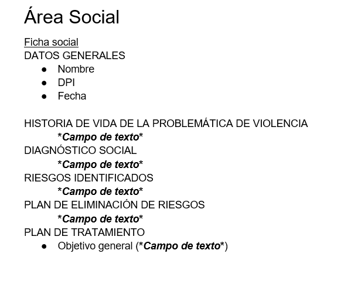
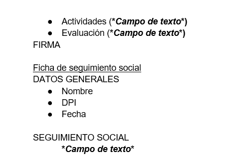

> Registro de una etapa de reconstrucción. El estado vigente, los resultados nuevos y las condiciones de integración están en [INTEGRACION_SOCIAL.md](../../INTEGRACION_SOCIAL.md).

# Ficha y seguimiento institucional de Trabajo Social

Referencia entregada y confirmada por Eduardo el 13 de noviembre de 2026. Estas imágenes definen el contenido solicitado, no nuevos permisos, obligatoriedades al confirmar ni estados.

## Confirmaciones

- Social tiene ficha social y hoja evolutiva propia, separada de Legal y de otras áreas.
- La ficha de seguimiento de la imagen corresponde al seguimiento de Social: cada anotación es cronológica y vinculada con su ficha; no sustituye notas anteriores ni crea una ficha Legal.
- La firma se hace en papel y luego se carga el PDF firmado. No capturar una firma digital ni crear una columna de texto para simularla.
- Nombre y DPI/CUI reutilizan la identidad autorizada de la beneficiaria. No son campos editables duplicados en ficha_social.

## Cobertura del contenido solicitado

| Elemento de las imágenes | Dato o relación existente | Estado en la reconstrucción |
| --- | --- | --- |
| Nombre | beneficiaria.nombre / identidad histórica de la cabecera | Reutilizar perfil y contexto autorizado; no duplicar |
| DPI | beneficiaria.cui / identidad histórica de la cabecera | Etiqueta DPI/CUI; mantener protección según permisos, sin exponerlo en listados |
| Fecha | formulario_area.fecha_atencion | Fecha de atención, distinta de captura automática |
| Historia de vida de la problemática de violencia | ficha_social.historia_violencia | Campo de texto existente; etiqueta alineada con la imagen |
| Diagnóstico social | ficha_social.diagnostico_social | Campo de texto existente |
| Riesgos identificados | ficha_social.riesgos_identificados | Texto existente, sin inventar un catálogo o total numérico |
| Plan de eliminación de riesgos | ficha_social.plan_eliminacion_riesgos | Campo de texto existente; etiqueta alineada |
| Plan de tratamiento: objetivo general | ficha_social.objetivo_general | Texto existente; no añadir otra columna plan_tratamiento duplicada |
| Plan de tratamiento: actividades | ficha_social.actividades | Texto existente; etiqueta alineada |
| Plan de tratamiento: evaluación | ficha_social.evaluacion | Texto existente; etiqueta alineada |
| Firma | PDF firmado asociado por documento_area.formulario_id | Carga conectada y probada por HTTP; no se asigna automáticamente un adjunto principal a firma_documento_id ni se valida una firma digital |
| Seguimiento: nombre y DPI | Identidad de la beneficiaria de la ficha Social | Reutilizar, sin segunda identidad independiente |
| Seguimiento: fecha | entrada_evolutiva.fecha_atencion | Esquema existente; reconstrucción de escritura diferida |
| Seguimiento social | entrada_evolutiva.contenido, asociada por formulario_id al tipo SOCIAL | Texto cronológico del área; completar captura y pruebas al reconstruir la hoja |

El registro técnico del seguimiento conserva además acción y profesional, establecidos por las reglas existentes del sistema. La imagen resumida no autoriza a quitarlos ni a rellenarlos con datos inventados. La vinculación con el formulario SOCIAL determina el área; no se mezcla con LEGAL.

Los campos adicionales de la versión vigente (vivienda, redes, coordinación y otros) no se eliminaron ni se volvieron obligatorios por interpretar las imágenes. Se conserva el diseño actual de cinco secciones, agrupando objetivo y actividades en el plan y evaluación en su sección vigente. La representación imprimible debe seguir el contenido institucional; no se creó todavía una impresión nueva.

## Cambios realizados en esta revisión

Las etiquetas de la ficha se definieron en frontend/src/modules/social/social-form.config.ts, con exportación pública en index.ts. El editor anterior consume esa definición mediante un puente temporal, sin duplicar las etiquetas. Se ajustó su prueba de navegación y conservación de valores al nuevo nombre institucional del campo. No se cambiaron claves API, tablas, obligatoriedades ni diseño.

Las imágenes se conservaron en docs/referencias/social. El plan y el registro de decisiones incorporan las confirmaciones, sin dar por resueltas las otras reglas pendientes de formularios o documentos.

## Entregas que siguen pendientes

1. Adaptador ORM de ficha Social completado en laboratorio: creación, edición, confirmación y descarte con auditoría y versión; ver RECONSTRUCCION_ADAPTADOR_SOCIAL.md. Quedan las reglas institucionales y autorización productiva pendientes.
2. Páginas propias de Social implementadas y probadas en local, manteniendo diseño y cabecera compartida; ver ../frontend/RECONSTRUCCION_SOCIAL_REACT.md. No acredita autorización productiva ni todos los flujos pendientes.
3. Asociación y consulta del PDF firmado conectadas mediante Documentos, probadas en PostgreSQL/HTTP; ver INTEGRACION_PDF_SOCIAL.md. Selección automática en Brave limitada por la extensión. Revisión documental y adjunto principal de firma no se dan por implementados.
4. Hoja evolutiva propia de Social: nuevas entradas, consulta y corrección con historial y filtros de área; se mantiene al final por la coordinación pendiente del esquema.

Esta revisión alinea el contenido y deja su cobertura documentada. No equivale a declarar terminados los dos formularios ni la carga del PDF.

## Verificación de esta revisión

Tipos frontend aprobados. Suite frontend: 147 pruebas aprobadas en la repetición final. La primera ejecución tuvo un fallo de espera en una prueba de Legal que buscaba el enlace de un error de campo; la repetición completa pasó sin cambios adicionales de código. No se considera resuelta la posible inestabilidad de esa prueba. Evidencias locales: test-results/social-contenido-check.log y test-results/social-contenido-retest.log. No se ejecutaron pruebas nuevas de escritura backend para este ajuste de etiquetas y documentación. Sin cambios remotos.
